

# Suivi de projet

---

## Semaine 1 (7–13 septembre)

### Travail réalisé
- Premier meeting avec Léna
- Prendre connaissance de toutes les plateformes à utiliser
    - Element, l'application MONA

J'ai fait ma premiere recontre avec Léna, qui m'as presenté maison MONA et expliqué le fonctionnement du projet.
Je suis allée a un des parcours proposé par la maison MONA, où on s'est promené dans Outremont pour découvrire les oeuvres d'art public. J'ai pu me familiariser avec l'application; photographier l'art, lire les descriptions, regarder mes photos sauvegardés, et prendre notes de choses que j'aimerais améliorer.

### Notes

!!! Choses pertinantes à mentionner pendant la réunion
    - Lors du tutoriel, on ne peut pas retourner en arrière
    - Peut pas changer la photo de l'oeuvre une fois téléversé dans l'app

## Semaine 2 (14–20 septembre)

### Travail réalisé
- Première réunion avec Anissa, Mariama, Jonathan et Léna
- Commencer mon site web
- Planifier les horaires où je pourrais travailler sur le projet 

Avec le début des cours j'ai consacré 2 plages horaires dans ma semaine pour travailler sur le projet, pendant lesquels j'ai pu commencer mon site web. J'ai aussi eu ma première reunion avec une partie de l'èquipe dev, où on m'as montré un peu le coté serveur de l'application ainsi que le fontionnement des réunions. De plus j'ai pu programmer une réunion pour la semaine prochaine avec Jonathan pour qu'il me montre le travail qu'il a réalisé cet été, ainsi que le fonctionnement du développement mobile chez la maison MONA.

## Semaine 3 (21–26 septembre)

### Travail réalisé
- Réunion avec Jonathan
- Installation de tout les fichiers pour dev

Jonathan a pu me montrer sur quoi il a travaillé cet été; les utilisaeurs recoivent une notification quand ils sont proches d'oeuvres à Montréal pour leur permettre de découvrir l'art autour d'eux, cependant il a implementé cela sur Android ce qui me pousse a voulour travailler sur l'implémentation Apple. Je cherche encore sur quoi faire le centre de mon projet ce semestre, je pense que pour commencer à me familiariser avec le développment je vais rajouter une option "Retour" pour la page tutoriel.  
J'ai eu une réunion avec Christian qui m'as aidé à installé les logiciels et les fichiers dont j'avais besoin, et par la suite j'ai ajouter la fonctionnalité du retour arrière dans le tutoriel de l'application. Cependant au lieu de faire une fléche retour arrière j'ai fait en sorte que lorsqu'on click sur la moitié gauche de l'écran on revient à la page d'avant et la moitié à droite pour passer a la page suivante.

### Notes

!!! Idées pour le projet
    - Notifications IOS
    - Améliorer la recherche dans l'annuaire
    - Améliorer la galerie dans "ma collection", ajouter un filtrage,..

Je pense choisir l'amélioration de la recherche dans l'annuaire avec ces sous-objectifs: 

<ol>
  <li>Repenser l'interface de recherche</li>
  <li>Ajouter plus de filtres (Quartier, type d'oeuvre, artiste, découvert ou pas)</li>
  <li>Ajouter options de tri</li>
  <li>Ajouter un checkbox si c'est découvert ou pas</li>
</ol>

Voici un petit schéma que j'ai fais pour avoir une petite visualisation

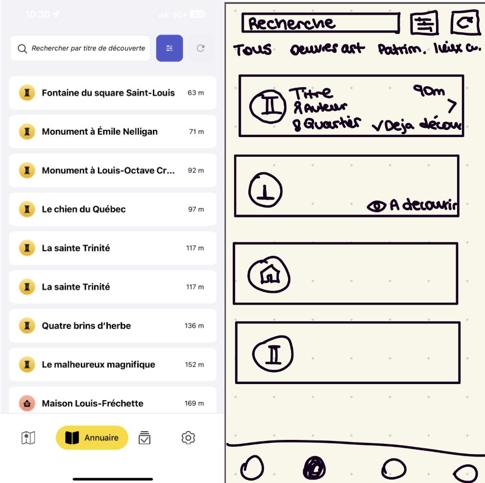
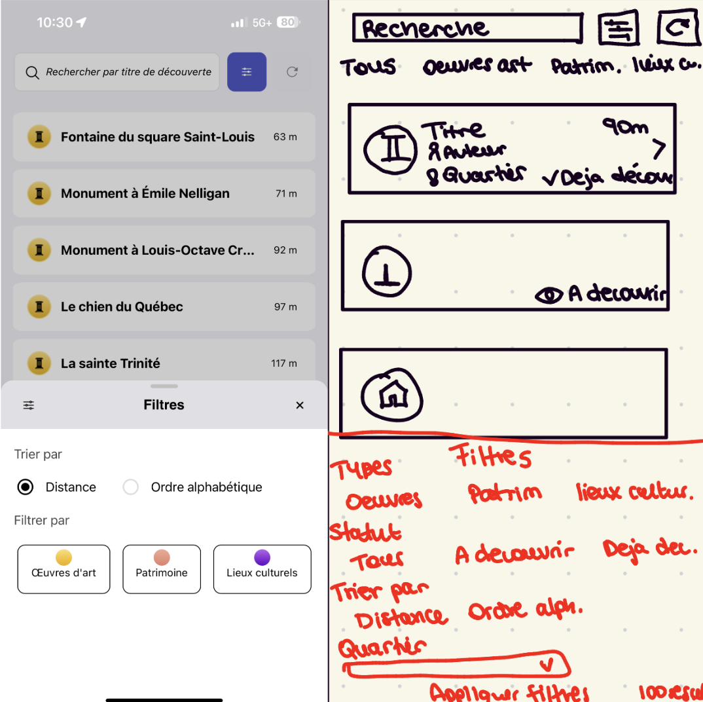

## Semaine 4 (28 septembre – 4 octobre)

### Travail réalisé
- Plus de précision sur les taches à accomplir pour le projet
- Benchmark
- Rendu la zone invitant l’utilisateur à prendre une photo cliquable
- Lecture de la documentation Ionic

J'ai eu une reunion avec l'equipe tech de la maison MONA(Léna, alix, Jonathan et Mariama), où j'ai pu leur expliquer mon projet, soit l'amélioration de la recherche. Léna m'as donné quelques idées que je pourrais ajouter a mon implémentation; lier les badges à la recherche, utiliser Mobbin pour benchmark d'autres applications qui ont une page de recherche. 
J'ai donc passé un après-midi sur le benchmark et de bien définir tout ce que je vais rajouter a la recherche;
Au niveau de la recherche:
<ol>
  <li>Ajouter la recherche par artiste (il va falloir créer des cartes pour chaque artiste)</li>
  <li>Permettre à l'utilisateur de faire des typos</li>
</ol>

Au niveau de l'interface:
<ol>
  <li>Première page, on peut choisir d'explorer les artistes, oeuvres d'art, lieux patrimoniaux, lieux culturels ou quartier</li>
  <ul>
    <li>Si on choisi artiste ou une découverte(oeuvres d'art, lieux patrimoniaux, lieux culturels) on a une liste avec barre alphabétique a droite</li>
    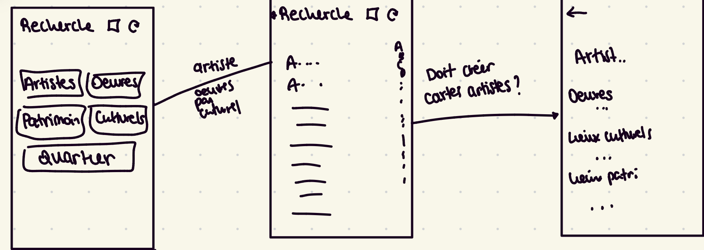
    <li>Si on choisi quartier, on a une page où on peut choisir un quartier avec le nombre de découvertes à cote, quand on choisi un quartier spécifique on a notre progression -/10 et toutes les découvertes</li>
    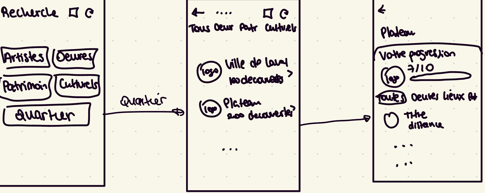
    <li>Si on choisi de rechercher, et ensuite les filtres qui sont: quartier, statut, période et le nombre de résultats s'affiche en dessous. Ensuite on peut chosiir de les trier par distance, ordre alphabétique ou par rating</li>
    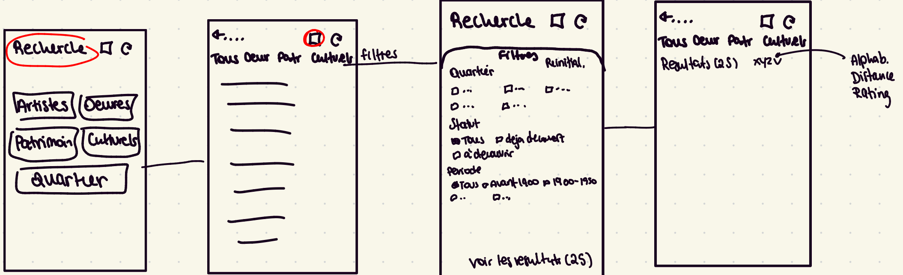
  </ul>
</ol>
Ensuite j'ai contacté Mariama qui s'occupe du coté serveur donc qui connait bien les données qu'on recoit de m'envoyer une liste des informations qu'on a sur chaque découverte qui arrive chez nous pour trouver d'autres filtres que je pourrais ajouter.

## Semaine 5 (25 octobre - 11 octobre)

### Travail réalisé
- Finalisation du benchmark
- Commencer le projet au niveau de la recherche
- Rendu une zone avec une image cliquable pour capturer une photo
- Ajouter des idées pour le projet

J'ai rendu une zone contenant une illustration qui invite l'utilisatuer de prendre une photo cliquable, l'utilisateur pourra cliquer sur le bouton "Photographier" ou directement sur la zone.

Après la réunion de la semaine passé, j'ai eu du feedback sur mes idées qui m'as permis d'ajouter quelques précision; surligner le mot tapé dans la barre de recherche dans les résultats qui ressortent dans l'annuaire(si l'utilisateur recherche monum alors dans les résultats monum sera surlignée). On a aussi penser a relier les badges quartiers à l'annuaire pour permettre a l'utilisateur de compléter ses badges plus facilement(quand l'utilisateur se trouve dans ses badges quartiers on lui affiche le nombre découvertes restantes pour acquérir le badge et il peut cliqué sur "Voir les découvertes" pour aller à la section du quartier correspondant dans l'annuaire avec une liste des découvertes)
J'ai aussi préparer une présentation pour ma vision de l'interface de l'annuaire pour montrer a Barbara lors de la réunion graphisme le 15 octobre.

En parallèle, j'ai fait quelques recherches et lu la documentation ionic au niveau des typos dans la recherche dans l'annuaire. J'ai trouvé qu'il va falloir que j'implémente le fuzzy search car ionic, par défaut nécessite une correspondance textuelle exacte. 
Donc j'ai commencé cette implémentation ainsi que celle de la recherche par nom d'artiste et le fait d'avoir le mot surligné dans les résultats.

## Semaine 6 (12 octobre - 18 octobre)

### Travail réalisé
- Fuzzy search, recherche fonctionne avec une faute
- Reunion avec l'èquipe tech et Barbara(graphiste) pour discuter de l'interface de l'annuaire et voir mes idées

J'ai crée une fonction isSimiliar qui verifie d'abord si le texte cherché apparait directement, sinon du moment que le mot à plus de 3 caractères fait appel au calcul de la distance de Levenshtein avec une limite de 2 caractères de différence.

## Semaine 7 (19 octobre - 25 octobre)

### Travail réalisé
J'ai d'abord exploré les APIs et avec l'aide de Léna trouvé une dédié aux artistes, donc j'ai crée un fichier ArtistDatabase.ts pour récupérer les artistes depuis l’API et les conserver dans une liste indépendante.

Jai trouvé qu'on a 824 artistes!!

Ensuite j'ai ajouté une méthode searchArtists() qui réutilise la logique de recherche existante pour chercher les artistes par nom.
Pour l'instant l'affichage reste juste le nom des artistes, il faut encore que je leur créer des pages de détails où l'utilisateur se retrouvera quand il cliquera sur son nom.

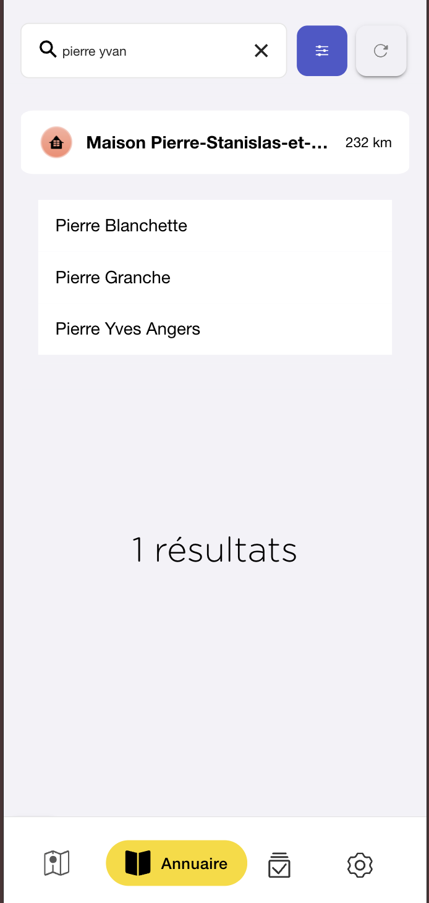
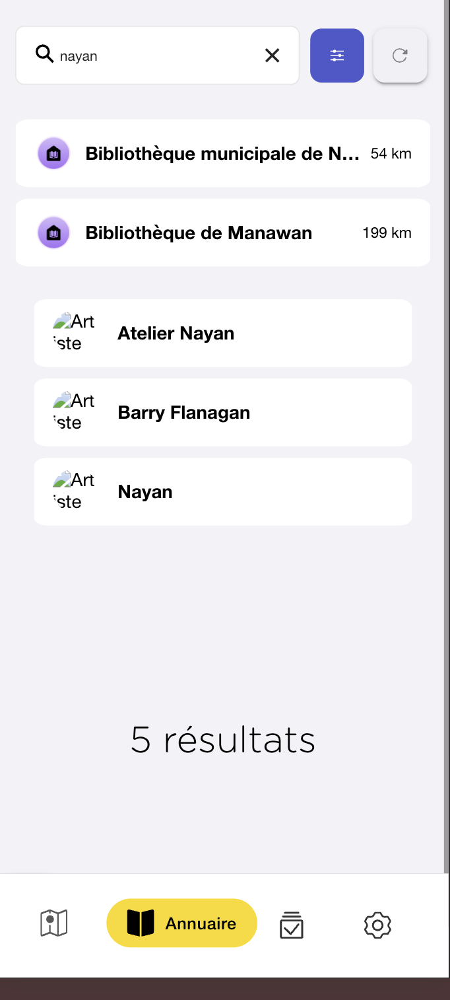

## Semaine 8 (26 octobre - 1 novembre)

### Travail réalisé
- Améliorer affichage de recherche générale(séparation entre artistes et découvertes)
- Page de détails de chaque artiste

Réunion avec Barbara où elle nous a montré ses wireframes, soit une vision concréte de l'annuaire qu'on a décidé de changer à une page d'exploration. 

Grace aux wireframes j'ai pu commencer a crée la page de recherche générale (artistes + découvertes) où on a une section artistes et une section découvertes avec tout les 2 un bouton "Tout Voir (nb de résultats)".

J'ai aussi commencé les pages détails de chaque Artiste, où on affiche son nom, une bréve description avec une liste de toutes ces oeuvres, mais j'ai rencontré des difficultés pour la description car dans l'API les seuls infos qu'on a sur eux sont des liens à des sites web. Donc j'ai mis les liens dans la description.

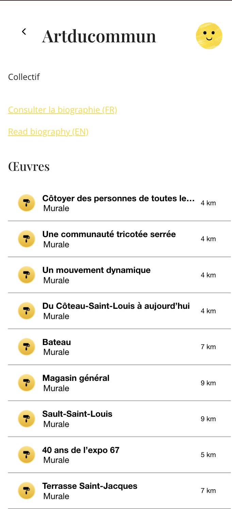

## Semaine 9 (2 novembre - 8 novembre)

### Travail réalisé
- Passe de l'annuaire à une page d'exploration
- Squelette de la page d'exploration
- Créer page avec la recherche filtré sur les catégories
- Changement de l'icon et nom de la section

J'ai commencé l'implémentation de la page d'exploration, où on a une section avec les différentes catégories et une section qui nous emmene a une recherche d'artistes uniquement.

Wireframes:

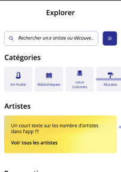

L'app:

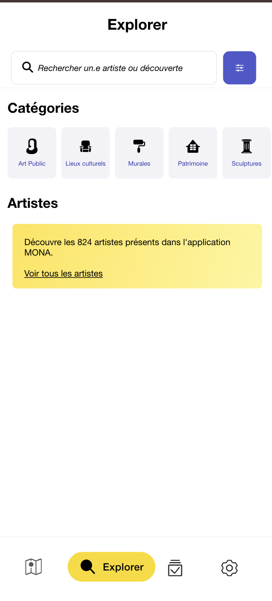

Pour les catégories j'ai commencé à mettre en place des pages individuelles pour chacune d'entre elle. L'idée est d'avoir une seule page réutilisable qui affiche les découvertes correspondant à la catégorie sélectionnée, plutôt que de créer six pages différentes. J'ai réutilisé les fonctionnalités déjà présentes dans la recherche de l'app, la récupération des découvertes triées par distance ou par ordre alphabétique, ainsi que le système d'icônes existant.

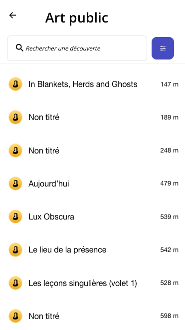

J'ai aussi renommé la section « Annuaire » en « Explorer » et remplacé l’image affichée en bas de la page par une image différente.
Voici l'avant - après:

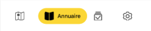
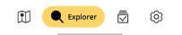

Enfin, j'ai commencé à adapter l'interface des pages de catégories pour qu'elle corresponde à la maquette, notamment au niveau de l'en-tête, de la barre de recherche et des espacements.

## Semaine 9 (9 novembre - 15 novembre)
### Travail réalisé
- Implémentation de Soundex(recherche phonétique)
- Ajuster le CSS des différentes pages à l'aide des wireframes

Lors de ma mise en commun 2 on a discuté de ma recherche autorisant 2 typos et on m’as proposé d'ajouter à cela l'algorithme phonétique Soundex. Du coup je me suis informé dessus et je l'ai ajouté a ma fonction isSimilair().